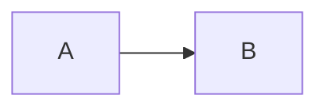

# ADR-NNNN: Título

- Status: proposto
- Data: AAAA-MM-DD
- Decisores: nomes ou papéis

## Contexto e Declaração do Problema

Quais forças motivam a decisão? Um parágrafo curto.

## Direcionadores da Decisão

- Direcionador

## Opções Consideradas

- Opção

## Resultado da Decisão

Opção escolhida: "Opção", porque motivo.

### Consequências

- Positivas: ...
- Negativas: ...
