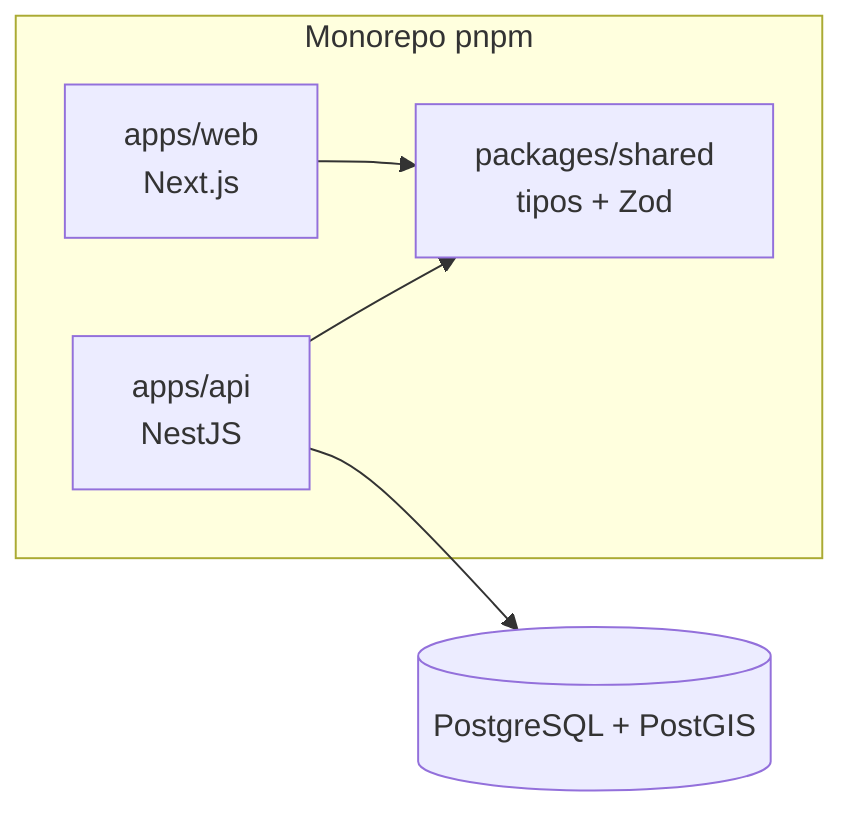

# ADR-0001: Stack TypeScript de ponta a ponta

- Status: aceito
- Data: 2026-11-14
- Decisores: Kaike, desenvolvedor sênior (a confirmar)

## Contexto e Declaração do Problema

A equipe tem três desenvolvedores: um sênior e dois juniores sem experiência. Todos usam assistentes de IA. Precisamos de uma stack única, bem estruturada, performática e fácil de configurar e testar localmente.

## Direcionadores da Decisão

- Poucas linguagens e ferramentas para aprender
- Tipagem forte compartilhada entre as camadas
- Setup local com um único comando
- Boa performance para buscas e chamadas de IA (I/O intensivo)
- Bom suporte dos assistentes de IA

## Opções Consideradas

- TypeScript de ponta a ponta (NestJS + Next.js)
- Java 21 + Spring Boot + Next.js
- Python (FastAPI) + Next.js

## Resultado da Decisão

Opção escolhida: "TypeScript de ponta a ponta", porque oferece uma linguagem e um único conjunto de ferramentas para toda a equipe, e os tipos podem ser compartilhados entre API e frontend.

Stack:

- Runtime: Node.js LTS, TypeScript em modo estrito
- Backend: NestJS, ORM Prisma, SQL puro para consultas PostGIS, validação com Zod
- Frontend: Next.js, Tailwind CSS, publicado na Vercel
- Ferramentas: workspaces pnpm, Vitest, Testcontainers, Playwright, ESLint, Prettier

### Consequências

- Positivas: uma linguagem, schemas compartilhados, um único conjunto de ferramentas e grande base de conhecimento para os assistentes de IA.
- Positivas: o Node lida bem com cargas de I/O.
- Negativas: a importação em massa do CNPJ precisa ser feita em streaming para respeitar o limite de memória.
- Negativas: o Prisma não modela tipos PostGIS, então as consultas de localização ficam em um único módulo de repositório.
