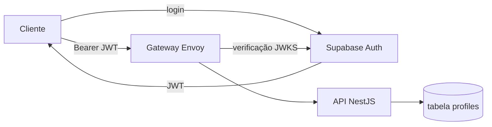

# ADR-0002: Autenticação com Supabase Auth, portável por design

- Status: aceito
- Data: 2026-11-14
- Decisores: Kaike, desenvolvedor sênior (a confirmar)

## Contexto e Declaração do Problema

Precisamos de login, recuperação de senha e verificação de e-mail para quatro papéis: administrador da plataforma, gestor da prefeitura, empresa e consumidor (a busca não exige login). O banco de dados já é o Supabase, e devemos conseguir sair do Supabase sem reescrever a aplicação.

## Direcionadores da Decisão

- Baixo custo operacional no MVP
- Fluxos de senha e e-mail prontos
- Dados de usuários e hashes de senha portáveis
- Tokens OpenID Connect (OIDC) padrão, para permitir trocar o provedor

## Opções Consideradas

- Supabase Auth
- Keycloak (auto-hospedado)
- Provedor gerenciado (Auth0, Clerk)
- Autenticação própria do zero

## Resultado da Decisão

Opção escolhida: "Supabase Auth", porque roda no banco de dados que já usamos e mantém uma saída aberta. A aplicação depende apenas de tokens OIDC, não de APIs específicas do Supabase.

Regras:

- Usuários são identificados pelo `sub` do token. Papéis e `municipality_id` ficam na nossa tabela `profiles`, nunca em `user_metadata` do Supabase, que o usuário pode editar.
- Senhas são hashes bcrypt, padrão do Supabase, para poderem ser importadas em outro lugar.
- Validar tokens pelo endpoint JWKS, nunca por segredo compartilhado.
- Hospedar na região de São Paulo, por latência e LGPD.

### Consequências

- Positivas: nenhum servidor de autenticação para operar; fluxos prontos.
- Positivas: a saída é um `pg_dump` do schema `auth`, seguido da importação de usuários e hashes.
- Negativas: o comportamento em produção difere do Keycloak local (veja ADR-0003). Coberto por teste de paridade em staging.
- Negativas: o plano gratuito pausa projetos inativos; é preciso um plano pago antes do piloto.
- A verificar: documentação atual de exportação e chaves de assinatura antes da implementação.
