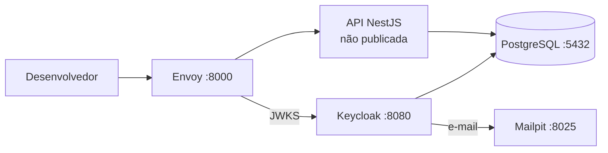

# ADR-0003: Desenvolvimento local com Docker Compose, Keycloak e Postgres

- Status: aceito
- Data: 2026-11-14
- Decisores: Kaike, desenvolvedor sênior (a confirmar)

## Contexto e Declaração do Problema

Em produção usamos o Supabase Auth, que não roda localmente sem a stack do CLI do Supabase. Os desenvolvedores precisam de um ambiente local fácil de iniciar, reprodutível e que exercite o mesmo fluxo de tokens da produção.

## Direcionadores da Decisão

- Um único comando para iniciar tudo
- Reprodutível para todos os desenvolvedores
- Tokens OIDC realistas para testes
- Simples o bastante para desenvolvedores juniores

## Opções Consideradas

- Keycloak + PostgreSQL em Docker Compose
- Stack local do Supabase CLI
- Emissor JWT falso, apenas nos testes

## Resultado da Decisão

Opção escolhida: "Keycloak + PostgreSQL em Docker Compose", porque é autocontido, reprodutível a partir do repositório e emite tokens OIDC reais. O Mailpit captura os e-mails enviados.

Regras:

- O realm (`infra/keycloak/realm.json`) é versionado e importado na inicialização.
- A porta da API não é publicada; todas as chamadas passam pelo Envoy.
- As credenciais do Compose são apenas para uso local e nunca devem ser reutilizadas em outro ambiente.
- As versões das imagens são fixadas.

### Consequências

- Positivas: `docker compose up` sobe todo o caminho, incluindo o gateway.
- Positivas: a equipe testa as mesmas rotas e regras do gateway da produção.
- Negativas: os tokens locais diferem dos do Supabase em emissor e formato de claims. A API mapeia as claims em um único módulo, e um teste em staging verifica o formato real.
- Negativas: o Keycloak consome memória na máquina do desenvolvedor.
