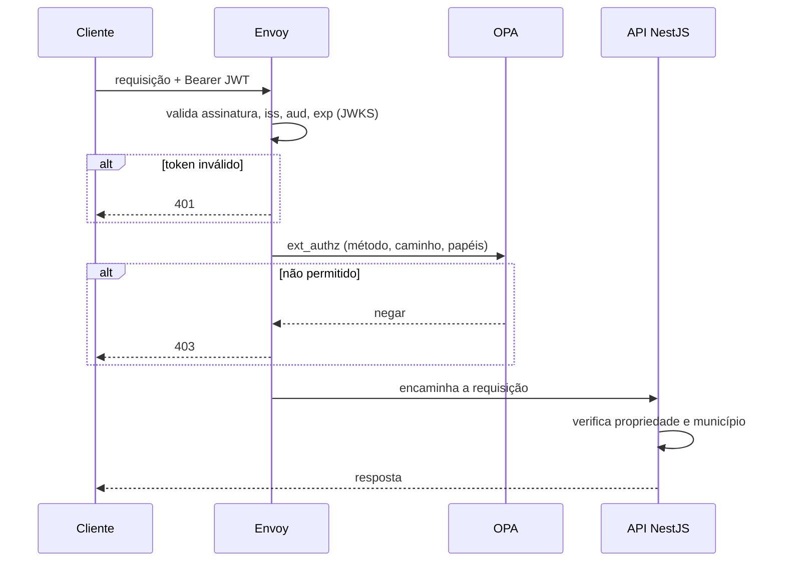

# ADR-0004: Gateway de API com Envoy e OPA

- Status: aceito
- Data: 2026-11-14
- Decisores: Kaike, desenvolvedor sênior (a confirmar)

## Contexto e Declaração do Problema

A API não pode ser acessível sem autenticação, e a autorização por papel (quais papéis podem chamar cada rota) deve ser aplicada antes que as requisições cheguem à aplicação. Regras de granularidade fina, como a propriedade de uma empresa, dependem de dados e permanecem na API.

## Direcionadores da Decisão

- Autenticação verificada uma única vez, na borda
- Regras de autorização em um único lugar, testável
- Funciona com qualquer provedor OIDC que publique JWKS (Keycloak e Supabase)
- Componentes abertos e neutros de fornecedor

## Opções Consideradas

- Envoy com `jwt_authentication` e OPA via `ext_authz`
- Kong ou Apache APISIX
- Traefik com um serviço ForwardAuth

## Resultado da Decisão

Opção escolhida: "Envoy com `jwt_authentication` e OPA via `ext_authz`", porque ambos são componentes padrão, neutros de fornecedor e totalmente abertos, e cada um faz uma única função.

Regras:

- O Envoy valida os tokens contra o JWKS do provedor. A API também verifica os tokens (defesa em profundidade).
- As políticas OPA ficam em Rego, em `infra/opa/`, e são testadas no CI.
- A API aceita tráfego apenas do Envoy, na rede interna.
- O gateway aplica papéis por rota; a API aplica regras por recurso.

### Consequências

- Positivas: um único ponto de aplicação para autenticação e autorização por rota.
- Positivas: políticas versionadas e com testes unitários.
- Negativas: a configuração do Envoy é verbosa; os juniores precisarão de um guia e exemplos.
- Negativas: as duas camadas de autorização precisam estar consistentes. Testes de integração chamam o gateway e cobrem: sem token, papel errado e token expirado.
- A verificar: versões atuais do Envoy e do OPA e a referência de configuração antes da implementação.
